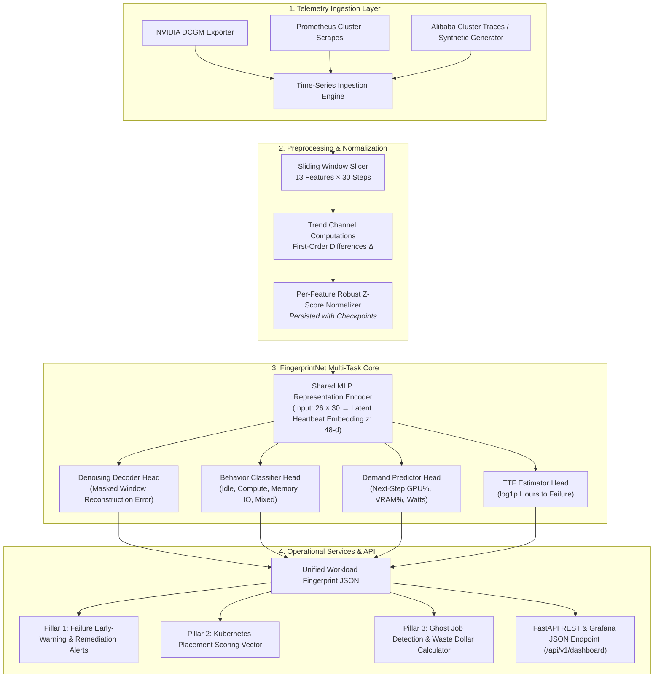

# 💓 Cluster Heartbeat — AI Telemetry & Predictive Operations for GPU Fleets

<div align="center">


[](https://python.org)
[](https://pytorch.org)
[](https://fastapi.tiangolo.com)
[](https://prometheus.io)
[](dashboards/grafana_dashboard.json)
[](docker-compose.yml)

<br/>

**One unified neural workload fingerprint driving GPU cluster reliability, scheduling efficiency, and cloud spend optimization.**  
*Continuous telemetry representation learning powered by multi-task deep autoencoders and NVIDIA DCGM metrics.*

[🚀 Quickstart](#-quickstart) • [🏛️ Architecture & Neural Pipeline](#️-architecture--neural-pipeline) • [📊 The 13 Telemetry Features](#-the-13-telemetry-features) • [🧠 FingerprintNet Engine](#-fingerprintnet-engine) • [📈 Dashboards & API](#-dashboards--rest-api)

---

</div>

## 📌 Executive Summary

Modern AI GPU clusters suffer from three fragmented operational headaches:
1. **Unpredictable Hardware Failures:** Thermal runaway, ECC memory corruption, and XID bus drops crash long-running multi-day LLM training jobs.
2. **Suboptimal Placement:** Standard Kubernetes schedulers only inspect static resource limits, oblivious to thermal stress, memory bandwidth saturation, and real-time degradation.
3. **Ghost Workloads & Cost Bleed:** Idle nodes and zombie containers reserve expensive VRAM while executing zero GPU compute.

**Cluster Heartbeat** solves this by unifying telemetry ingestion. Instead of running three disconnected monitoring tools, a multi-head PyTorch neural network (*FingerprintNet*) compresses each node's multi-metric trajectory into a single **compact 48-dimensional workload fingerprint**. From this single latent representation, three intelligent services operate simultaneously:

| Pillar | Service | Operational Impact |
|:---:|:---|:---|
| **Pillar 1** | **Predictive Failure Detection** | Detects subtle multi-metric correlation drift *hours before* thresholds trigger, outputting estimated Time-To-Failure (TTF) with per-feature attribution. |
| **Pillar 2** | **Behavior-Aware Smart Scheduling** | Ranks cluster nodes by *predicted* free capacity, thermal health, and failure risk for Kubernetes Scheduler Framework plugins. |
| **Pillar 3** | **GPU Cloud Cost Optimization** | Automatically isolates underutilized allocations and "ghost jobs" (allocated VRAM, 0% compute) and calculates reclaimable OPEX. |

---

## 🏛️ Architecture & Neural Pipeline



---

## 📊 The 13 Telemetry Features

Defined in [`configs/features.yaml`](configs/features.yaml), sampled every 60 seconds over a sliding 30-minute window:

| Index | Metric Name | Source / Exporter | Unit | Description |
|:---:|:---|:---|:---:|:---|
| `00` | `gpu_utilization` | NVIDIA DCGM | % | Percentage of time kernels are active on GPU cores |
| `01` | `gpu_memory_util` | NVIDIA DCGM | % | High-bandwidth VRAM allocation ratio |
| `02` | `gpu_temperature` | NVIDIA DCGM | °C | Thermal sensor reading on die package |
| `03` | `power_usage` | NVIDIA DCGM | Watts | Real-time board power draw |
| `04` | `ecc_errors` | NVIDIA DCGM | count | Correctable / uncorrectable memory error counter |
| `05` | `xid_errors` | Kernel / DCGM | code | NVIDIA driver critical event interrupt code |
| `06` | `cpu_usage` | Node Exporter | % | Host CPU compute utilization |
| `07` | `ram_usage` | Node Exporter | % | Host system memory consumption |
| `08` | `net_throughput` | Node Exporter | MB/s | Host network interface transmission rate |
| `09` | `disk_io` | Node Exporter | MB/s | Scratch disk / NFS write and read throughput |
| `10` | `job_runtime` | Slurm / Kube | hours | Elapsed run duration of currently scheduled pod/job |
| `11` | `queue_length` | Scheduler | count | Number of pending jobs waiting on node placement |
| `12` | `active_processes` | OS Procfs | count | Active PID count utilizing GPU contexts |

---

## 🧠 FingerprintNet Engine

### Self-Supervised Denoising Representation Learning
A major breakthrough of FingerprintNet is **channel-masking during training**. By intentionally obscuring random telemetry channels during forward passes, the network is forced to learn cross-feature correlations (e.g., *if GPU utilization is 98%, power draw must track proportionally, and temperature must follow a first-order thermal lag curve*).

When an anomalous physical event occurs (such as failing cooling fans or bus degradation where temperature spikes while compute is zero), the reconstruction error spikes immediately — **flagging failures 2–6 hours before traditional static threshold alarms trigger**.

### Multi-Task Output Vector
$$\mathbf{z} = \text{Encoder}(\mathbf{X}_{t-30:t}, \Delta \mathbf{X}_{t-30:t}) \in \mathbb{R}^{48}$$
From $\mathbf{z}$, the engine produces:
- **Anomaly Score:** Top-$k$ aggregated reconstruction error normalized against healthy fleet baseline.
- **Workload Classification:** Softmax probabilities over `[idle, compute_bound, memory_bound, io_bound, network_bound, mixed]`.
- **Demand Vector:** Predicted next-step utilization and wattage.
- **Estimated TTF:** $\log(1 + \text{hours})$ bounded to a 12-hour honesty window.

---

## 📁 Repository Structure

```plaintext
cluster-heartbeat/
├── configs/                  # Typed YAML configurations (features, models, ablation)
│   ├── default.yaml          # Master pipeline hyperparameters & paths
│   └── features.yaml         # Canonical 13-feature definitions & validity bounds
├── src/cluster_heartbeat/    # Core Python library
│   ├── config.py             # Dataclass-based typed configuration loader
│   ├── data/                 # Ingestion, physical clipping, sliding windows, z-scores
│   ├── models/               # PyTorch FingerprintNet & PCA baseline implementations
│   ├── training/             # Multi-task loss functions, masking, checkpointing
│   ├── inference/            # Streaming window scoring & per-feature explainability
│   ├── services/             # Three operational pillars (failure, scheduling, cost)
│   └── api/                  # FastAPI web server & Prometheus exporters
├── dashboards/               # Grafana dashboard JSON models ready for import
├── deploy/                   # Prometheus & Grafana container configurations
├── scripts/                  # Data generators, training runners, inference test CLI
├── tests/                    # Pytest test suite (shapes, scoring, API contracts)
├── docker-compose.yml        # Multi-container demo environment
├── Dockerfile                # Production container specification
├── Makefile                  # Automation targets (lint, test, run, clean)
└── requirements.txt          # Python library dependencies
```

---

## ⚡ Quickstart

### 1. Environment Setup
```bash
git clone https://github.com/nahidzaman1996271-sketch/cluster-heartbeat.git
cd cluster-heartbeat

python -m venv venv
# Windows:
.\venv\Scripts\activate
# Linux/macOS:
source venv/bin/activate

pip install -r requirements.txt
pip install -e .
```

### 2. Generate Synthetic DCGM Telemetry
Creates a 16-node cluster running 12 hours of realistic GPU training workloads with injected degradation incidents:
```bash
python scripts/generate_synthetic.py --out data/synthetic
```

### 3. Train FingerprintNet
```bash
python scripts/train.py --config configs/default.yaml
```

### 4. Run Inference & Generate Fleet Health Report
```bash
python scripts/run_inference.py --checkpoint checkpoints/best --input data/synthetic
```

### 5. Launch API Server
```bash
uvicorn src.cluster_heartbeat.api.main:app --host 0.0.0.0 --port 8000 --reload
```
Visit `http://localhost:8000/docs` for interactive Swagger API documentation.

---

## 🐳 Docker & Full Stack Deployment

Run the complete observability stack (API + Prometheus scraper + Grafana dashboards) in a single command:
```bash
docker compose up -d
```
- **FastAPI Endpoint:** `http://localhost:8000`
- **Prometheus Metrics:** `http://localhost:9090`
- **Grafana Fleet Dashboard:** `http://localhost:3000` (Default credentials: `admin` / `admin`)

---

## 👥 Hackathon Team & Acknowledgments

- **Hackathon:** AI for Cluster Intelligence Hackathon
- **Team:** Team Slow Walker
- **Team Leader:** Nahid Ibn Zaman
- **Project Mentor:** Md Adib Hossain

---

<div align="center">
  <sub>Developed with ❤️ by <a href="https://github.com/nahidzaman1996271-sketch">Nahid Zaman</a> and Team Slow Walker</sub>
</div>
